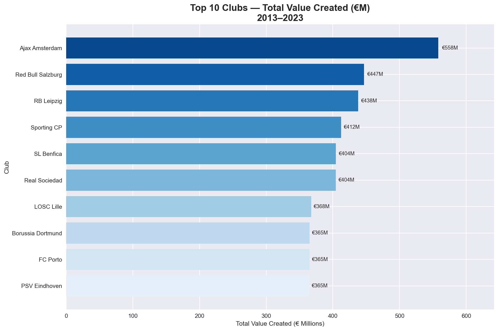

# Football Market Value Growth Analysis

## Overview

This project analyzes football clubs' ability to generate player market value between 2013 and 2023 using public football data based on Transfermarkt records.

The goal is to estimate how much player market value was created while players were associated with each club, then rank clubs by total value created.

## Analytical Question

Which football clubs generated the most player market value between 2013 and 2023?

Supporting questions:

- Which clubs created the highest total player market value?
- Which clubs showed the strongest average growth rate?
- Is the number of analyzed players correlated with total value created?
- Does a high positive growth rate necessarily lead to higher total value creation?
- Which clubs lost the most market value during the period?

## Dataset

The analysis uses football data available on Kaggle:

[Player Scores - Transfermarkt Dataset](https://www.kaggle.com/datasets/davidcariboo/player-scores)

Main files used:

- `player_valuations.csv`
- `players.csv`

Raw CSV files are not included in this repository by default. To reproduce the analysis, download the dataset from Kaggle and place the required files in:

```text
data/raw/
```

## Tools

- Python
- pandas
- numpy
- seaborn
- matplotlib
- Jupyter Notebook
- VS Code

## Methodology

The analysis follows these steps:

1. Load player valuation records and player metadata.
2. Merge valuation records with player names.
3. Convert dates and market values to appropriate data types.
4. Filter records between 2013 and 2023.
5. Sort each player's valuation history chronologically.
6. Identify each period in which a player was associated with a club.
7. Calculate initial value, final value, absolute value growth, and percentage growth for each player-club period.
8. Filter short or low-value periods to reduce noise.
9. Aggregate results at club level.
10. Rank clubs by total value created.

Filters applied:

- Period: 2013-2023.
- Minimum player-club period duration: more than 90 days.
- Minimum initial market value: EUR 100,000.
- Minimum players per club: 5.

## Key Metrics

- `total_value_created`: total increase or decrease in player market value while associated with a club.
- `avg_value_created`: average value created per player-club period.
- `median_value_created`: median value created per player-club period.
- `avg_growth_pct`: average percentage growth.
- `players`: number of unique players analyzed for the club.
- `positive_rate`: share of valid cases with positive value growth.

## Key Findings

The analysis processed 394,199 valuation records and evaluated 1,061 clubs after applying the filters.

Top clubs by total value created:

| Rank | Club | Total Value Created |
|---:|---|---:|
| 1 | Ajax Amsterdam | EUR 557.9M |
| 2 | Red Bull Salzburg | EUR 446.8M |
| 3 | RB Leipzig | EUR 438.0M |
| 4 | Sporting CP | EUR 412.2M |
| 5 | SL Benfica | EUR 404.5M |
| 6 | Real Sociedad | EUR 404.3M |
| 7 | LOSC Lille | EUR 367.6M |
| 8 | Borussia Dortmund | EUR 365.0M |
| 9 | FC Porto | EUR 364.9M |
| 10 | PSV Eindhoven | EUR 364.7M |

Additional insights:

- Ajax Amsterdam ranked first, creating approximately EUR 557.9M in total player market value.
- Red Bull Salzburg had one of the strongest positive growth rates among the top clubs.
- The correlation between number of analyzed players and total value created was moderate.
- The correlation between positive growth rate and total value created was low, suggesting that total value creation depends not only on frequency of successful cases but also on the magnitude of each player's growth.
- Some globally prominent clubs appeared among the lowest total value creators in this methodology, reflecting market value decreases for many players during their associated periods.

## Visualization



## Project Structure

```text
football-market-value-growth-analysis/
|
|-- README.md
|-- requirements.txt
|-- .gitignore
|
|-- data/
|   |-- raw/
|   `-- processed/
|
|-- notebooks/
|   `-- 01_market_value_growth_analysis.ipynb
|
|-- src/
|   `-- market_value_analysis.py
|
|-- outputs/
|   |-- figures/
|   |   `-- club_value_analysis.png
|   `-- tables/
|
`-- docs/
    |-- methodology.md
    `-- publication_guide_pt.md
```

## How to Run

Clone the repository:

```bash
git clone https://github.com/YOUR-USERNAME/football-market-value-growth-analysis.git
cd football-market-value-growth-analysis
```

Create and activate a virtual environment:

```bash
python -m venv .venv

# Windows
.venv\Scripts\activate

# macOS/Linux
source .venv/bin/activate
```

Install dependencies:

```bash
pip install -r requirements.txt
```

Download the Kaggle dataset and place these files in `data/raw/`:

```text
player_valuations.csv
players.csv
```

Run the script:

```bash
python src/market_value_analysis.py
```

Or open the notebook:

```bash
jupyter notebook notebooks/01_market_value_growth_analysis.ipynb
```

## Limitations

Market value data is an estimate and may be influenced by external factors such as transfer rumors, injuries, contract length, player age, league exposure, and broader market inflation.

The methodology attributes value change to the club associated with each valuation period, but this does not prove causality. A club appearing high in the ranking may reflect strong recruitment, player development, timing, scouting efficiency, or market positioning.

## Conclusion

The analysis highlights clubs that consistently appeared in player value growth periods between 2013 and 2023. Clubs such as Ajax Amsterdam, Red Bull Salzburg, RB Leipzig, Sporting CP, Benfica, and Porto stand out due to their ability to generate significant market value across multiple players.

This project demonstrates exploratory data analysis, data cleaning, aggregation, metric design, and visualization using Python.
